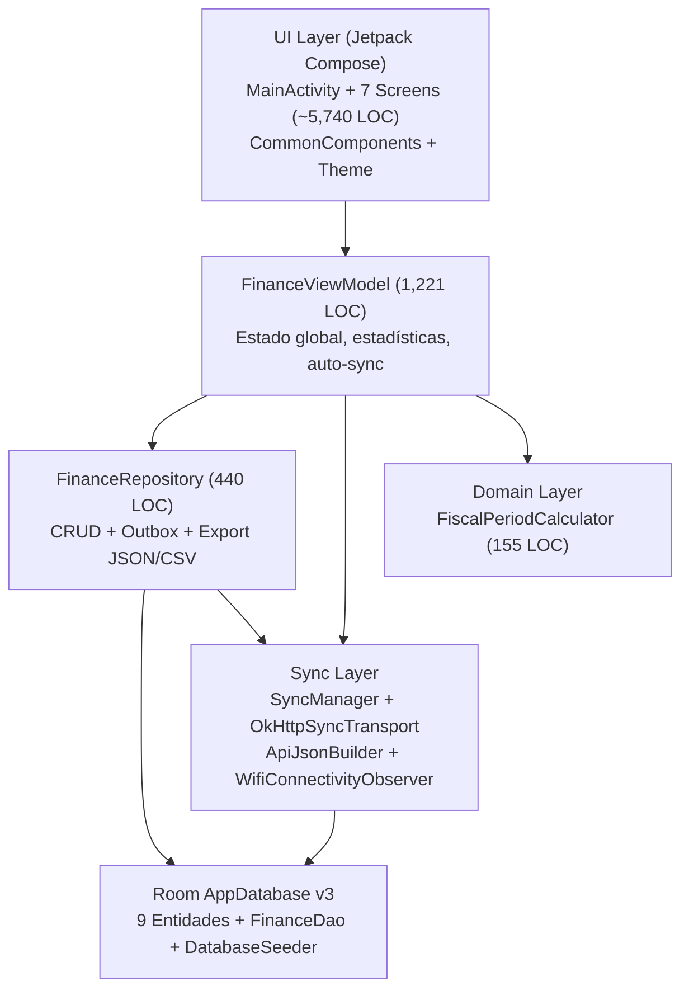

# Informe de Análisis Profundo del Estado del Proyecto — *Mis Finanzas* (Android)

> **Repositorio:** `JimenezW/appfinance`  
> **Versión actual:** `1.1` (`versionCode = 2`)  
> **Objetivo de integración:** `v1.2` ↔ `backFinanceApp v0.4.0` (según [`docs/02-guia-integracion-app-movil-seguridad-y-apis.md`](./02-guia-integracion-app-movil-seguridad-y-apis.md))  
> **Fecha de evaluación:** 20 de noviembre de 2026

---

## 1. Resumen Ejecutivo

**Mis Finanzas** es una aplicación Android nativa (*offline-first*) construida con **Kotlin + Jetpack Compose + Material 3 + Room + OkHttp**. En su versión actual (`v1.1`), el producto cuenta con una **base funcional local sólida**: captura rápida de gastos/ingresos en cascada, cálculo automático de periodo fiscal con corte el día 15, saldos por cuenta con reconciliación atómica, reglas programadas recurrentes, ergonomía inteligente (elementos fijados y ordenamiento por frecuencia de uso), exportación manual JSON/CSV y una cola *outbox* con sincronización automática por Wi-Fi.

Sin embargo, el contraste contra la guía oficial de integración con `backFinanceApp v0.4.0` revela **brechas críticas de arquitectura, modelo de datos y seguridad** que impiden conectar la app directamente al backend sin una refactorización planificada hacia `v1.2`:

| Dimensión | Estado actual (`v1.1`) | Madurez | Bloqueante para `backFinanceApp v0.4.0` |
| :--- | :--- | :---: | :---: |
| Funcionalidad local offline-first | Completa (captura, saldos, programados, admin, exportación) | 🟢 Alta | No |
| Precisión monetaria y periodo fiscal | Centavos en `Long` y corte día 15 validados con tests | 🟢 Alta | No |
| Modelo de datos (UUIDs, `default`, soft delete) | IDs `Long` autoincrementales, sin `default` ni `code` en tipos | 🔴 Crítica | **Sí** |
| Seguridad criptográfica (ECDSA P-256 + Keystore + Biometría) | No implementada (usa `Bearer` simple, sin `deviceId` ni firma) | 🔴 Crítica | **Sí** |
| Contrato de sincronización (`/api/v1/sync/*`) | Payload `wifi_sync_batch` incompatible; sin pull `/changes` ni fallos parciales | 🔴 Crítica | **Sí** |
| Seguridad de transporte y backup | Sin `network_security_config.xml`; `allowBackup="true"` sin exclusiones | 🟠 Media-Alta | **Sí (en release)** |
| Calidad de código y mantenibilidad | `FinanceViewModel` (1,221 LOC) y pantallas monolíticas; recálculos en getters | 🟡 Media | No (deuda técnica) |
| Cobertura de pruebas | 3 suites reales + 2 plantillas; sin tests de migración ni criptografía | 🟡 Media-Baja | Recomendado |

---

## 2. Inventario Técnico y Arquitectura Actual

### 2.1. Stack y Configuración de Compilación
- **Identidad:** `applicationId = "com.aistudio.misfinanzas.krmvpx"`, `namespace = "com.example"` (`app/build.gradle.kts`).
- **SDKs:** `minSdk = 24`, `targetSdk = 36`, `compileSdk = 36` (`minorApiLevel = 1`), Java 11.
- **Dependencias activas:**
  - Kotlin `2.2.10`, AGP `9.1.1`, KSP `2.3.6`.
  - Jetpack Compose BOM `2024.09.00` (Material 3, Icons Extended, Activity Compose `1.10.1`, Lifecycle `2.8.7`).
  - Room `2.7.0` (`room-runtime`, `room-ktx`, `room-compiler`).
  - OkHttp `4.10.0`, Coroutines `1.10.2`.
  - Testing: JUnit `4.13.2`, Robolectric `4.16.1`, Coroutines Test `1.10.2`, Compose UI Test.
- **Dependencias declaradas pero comentadas en `app/build.gradle.kts`:** Retrofit `2.12.0`, Moshi `1.15.2`, `logging-interceptor`, DataStore, Navigation Compose, Firebase.
- **Historial Git:** 3 commits en `main` (`da770cf` → `b225322` → `ee44f3b`), árbol limpio antes de este análisis.

### 2.2. Mapa de Módulos y Distribución de Código
El proyecto suma ~10,000 líneas de Kotlin distribuidas en 25 archivos de producción y 5 archivos de prueba:

### 2.3. Inventario de Funcionalidad Implementada (`v1.1`)
1. **Captura Inmediata (`CaptureScreen.kt` — 1,494 LOC):**
   - Teclado numérico propio, selección en cascada `Tipo → Clasificación → Detalle → Cuenta → Comercio → Nota`.
   - Atajos rápidos de ingresos, creación rápida inline de clasificaciones y detalles, fijado de favoritos (`isPinned`) y ordenamiento dinámico (`fijados → frecuencia de uso → recencia → sortOrder`).
   - Indicador visual del periodo fiscal calculado y del corte de día 15.
2. **Saldos y Movimientos (`BalancesScreen.kt` — 893 LOC):**
   - Navegación por periodo fiscal, filtro por cuenta, búsqueda textual, desglose de gastos/ingresos por categoría con barra de presupuesto mensual (`monthlyBudgetCents`) y edición/eliminación de movimientos con reconciliación atómica de saldos.
3. **Movimientos Programados (`ScheduledScreen.kt` — 801 LOC):**
   - Reglas recurrentes por día del mes o fin de mes (`isEndOfMonth`), ventana de notificación de 2 días, confirmación atómica (crea transacción + actualiza saldo + marca `lastConfirmedPeriodKey`) y posposición 24h (`snoozedUntilEpochDay`).
4. **Administración, Sincronización y Exportación (`AdminScreen.kt`, `AdminCatalogCrudViews.kt`, `SyncAndExportSection.kt`):**
   - CRUD completo de clasificaciones (con presupuesto mensual), detalles, cuentas, comercios y reglas programadas.
   - Panel de estado Wi-Fi en vivo, interruptor de auto-sync, vista previa del payload JSON, exportación SAF de 4 formatos (`admin_configuration`, `captured_transactions`, `full_backup`, CSV) e historial de los últimos 25 elementos de `sync_queue`.
5. **Base de Datos (`AppDatabase.kt` v3):**
   - 9 tablas: `transaction_types`, `classifications`, `detail_items`, `accounts`, `merchants`, `scheduled_rules`, `finance_transactions`, `sync_queue`, `sync_settings`.
   - Migraciones incrementales existentes: `MIGRATION_1_2` (añade outbox y columnas de sync) y `MIGRATION_2_3` (añade `isPinned`).

---

## 3. Análisis de Brechas (Gap Analysis): `v1.1` Actual vs `backFinanceApp v0.4.0` (`v1.2`)

A continuación se contrasta cada requerimiento de [`02-guia-integracion-app-movil-seguridad-y-apis.md`](./02-guia-integracion-app-movil-seguridad-y-apis.md) contra el código actual.

### 3.1. Cambios de Modelo de Datos

| Requisito `v1.2` | Estado actual en `Entities.kt` / `DatabaseSeeder.kt` | Brecha / Impacto |
| :--- | :--- | :--- |
| **UUID (`String`) en todas las entidades** (`id`, `typeId`, `classificationId`, `detailId`, `accountId`) | Solo `FinanceTransactionEntity.id` es `String`. Clasificaciones, detalles, cuentas, comercios y reglas usan `@PrimaryKey(autoGenerate = true) val id: Long = 0`. | **Crítica.** Requiere migración Room `v3 → v4` recreando tablas, cambiando PKs/FKs a `String` y refactorizando DAO, Repository, ViewModel y pantallas UI. |
| **UUIDv5 deterministas en catálogo base + UUIDv4 offline** | `DatabaseSeeder` inserta con autoincremento local `Long`. | **Crítica.** El catálogo inicial debe alinearse a los UUIDv5 del backend (idealmente hidratando desde `GET /api/v1/catalogs/admin-config` o replicando el generador UUIDv5 en semilla offline). |
| **`TransactionType` con `id` (UUID), `code` (`GASTO`/`INGRESO`) y `name`** | `TransactionTypeEntity(id: String, name: String, sortOrder: Int)` usa `"GASTO"` / `"INGRESO"` directamente como `id` y no tiene `code`. | **Alta.** Agregar columna `code` y migrar `typeId` de tablas hijas al UUID del tipo (conservando la lógica de negocio sobre `code`). |
| **Bandera `default: Boolean`** en entidades de catálogo/negocio | Inexistente en todas las entidades. | **Alta.** Agregar `isDefault: Boolean` (serializado como `"default"` en JSON): `true` para semilla base, `false` para registros creados por el usuario. |
| **Campo `currency` en `AccountEntity`** | Inexistente (se asume MXN implícito). | **Media.** Agregar `currency: String = "MXN"` para compatibilidad con `/api/v1/accounts`. |
| **Soft delete** (`deletedAtMillis` / `isDeleted`) | `FinanceDao` realiza `@Delete` físico (`DELETE FROM ...`). | **Alta.** Para soportar sincronización bidireccional (`/sync/changes`) y evitar referencias huérfanas, conviene adoptar *soft delete* o tombstone consistente. |
| **Precisión monetaria en centavos (`Long`)** | Implementado (`amountCents`, `balanceCents`, `monthlyBudgetCents`). | ✅ **Cumplido.** |
| **Periodo fiscal con corte día 15** | Implementado en `FiscalPeriodCalculator` y probado en unit tests. | ✅ **Cumplido.** |

### 3.2. Seguridad (Sin Login: Keystore ECDSA P-256 + Biometría + TOFU)

| Requisito `v1.2` | Estado actual | Brecha / Impacto |
| :--- | :--- | :--- |
| **`deviceId` (UUIDv4) persistido en `SyncSettingsEntity`** | `SyncSettingsEntity` solo guarda `apiEndpointUrl`, `apiAuthToken`, `autoSyncOnWifi`, `deviceLabel` y timestamps. | **Crítica.** Agregar `deviceId`, `enrollmentToken` (idealmente cifrado), `isDeviceEnrolled`, `isDeviceRevoked` y `lastSyncServerMillis`. |
| **Par de llaves ECDSA P-256 en `AndroidKeyStore`** (`secp256r1`, `SHA256withECDSA`, exportación SPKI DER Base64) | No implementado. | **Crítica.** Crear componente `DeviceKeyManager` / `DeviceSigner` usando `KeyPairGenerator` con `ECGenParameterSpec("secp256r1")` en `AndroidKeyStore`. |
| **Protección biométrica local (`BiometricPrompt`)** vinculada a la llave (`setUserAuthenticationRequired(true)`) | Sin dependencia `androidx.biometric` ni flujo de desbloqueo. | **Alta.** Integrar `androidx.biometric:biometric` y diseñar el flujo de autorización (evaluando si `setUserAuthenticationRequired(true)` usa ventana de validez por segundos para no bloquear el auto-sync en segundo plano, o `CryptoObject` interactivo). |
| **Interceptor OkHttp con firma canónica** `{METHOD}\|{PATH_AND_QUERY}\|{deviceId}\|{timestampMillis}\|{nonce}\|{bodySha256}` | `OkHttpSyncTransport` envía `Authorization: Bearer <token>` sin firma ni interceptor. | **Crítica.** Reemplazar el esquema `Bearer` por un `DeviceSignatureInterceptor` que lea `rawBodyBytes` una sola vez, calcule `SHA-256` hex minúsculas, firme el mensaje canónico y agregue `X-Device-Id`, `X-Timestamp`, `X-Nonce`, `X-Signature`, `X-Request-Id` y (en primer contacto TOFU) `X-Device-Public-Key`, `X-Enrollment-Token`, `X-Device-Label`. |
| **`Idempotency-Key` en `POST` críticos** | No implementado. | **Media.** Generar y persistir UUIDv4 por operación para evitar duplicados en reintentos de `/transactions` y `/scheduled-rules/:id/confirm`. |
| **Transporte seguro (`network_security_config.xml`)** | No existe el archivo XML ni `android:networkSecurityConfig` en `AndroidManifest.xml`. `OkHttpSyncTransport` acepta `http://` en cualquier build. | **Alta.** Crear `res/xml/network_security_config.xml` con `cleartextTrafficPermitted="false"` en `release` y permitir cleartext solo en `debug` para desarrollo local (`:3003`). |
| **Manejo específico de códigos HTTP de seguridad** (`401 TIMESTAMP_EXPIRED`, `REPLAY_DETECTED`, `INVALID_SIGNATURE`, `403 DEVICE_REVOKED`, `INVALID_ENROLLMENT_TOKEN`, `429 RATE_LIMIT_EXCEEDED`) | `SyncManager` trata todos los códigos no-2xx de forma genérica (`SyncPhase.ERROR`). | **Alta.** Parsear el sobre estándar `{ success, error: { code, message, details }, meta }` y reaccionar según cada código (ej. detener auto-sync en `DEVICE_REVOKED`, aplicar *exponential backoff* en `429`, regenerar nonce/timestamp en `REPLAY_DETECTED`). |

> **Nota documental importante:** El archivo existente [`docs/ARQUITECTURA_FIRMA_DISPOSITIVO_JSON.md`](./ARQUITECTURA_FIRMA_DISPOSITIVO_JSON.md) definía un mensaje canónico preliminar `{deviceId}|{timestampMillis}|{nonce}|{bodySha256}` (sin `METHOD` ni `PATH_AND_QUERY` y sin `X-Enrollment-Token`). La fuente de verdad oficial ahora es [`docs/02-guia-integracion-app-movil-seguridad-y-apis.md`](./02-guia-integracion-app-movil-seguridad-y-apis.md). Se recomienda anotar el documento anterior como referencia histórica para evitar discrepancias de firma (`401 INVALID_SIGNATURE`).

### 3.3. Contrato de Sincronización y Consumo de APIs

1. **Incompatibilidad estructural en `POST /api/v1/sync/batch`:**
   - **Actual (`ApiJsonBuilder.kt:343-362`):**
     - Omite `deviceId`.
     - Envía `adminChanges` como un **arreglo plano** de eventos de cola (`[{ queueId, entityType, entityId, operation, data }]`).
     - Envía `deletedTransactions` como objetos envueltos (`{ queueId, transactionId, deletedAtMillis, payload }`).
   - **Requerido (`backFinanceApp v0.4.0`):**
     - Incluye `deviceId` (UUIDv4) en la raíz.
     - Envía `adminChanges` como un **objeto agrupado por entidad**: `{ classifications: [], details: [], merchants: [], accounts: [], scheduledRules: [], deletedIds: { classifications: [], details: [], merchants: [], accounts: [], scheduledRules: [] } }`.
     - `capturedTransactions` debe enviar IDs en formato UUID y campos limpios según contrato.
2. **Procesamiento de respuesta y fallos parciales (`SyncManager.kt:114-134`):**
   - Actualmente cualquier HTTP `2xx` marca **todos** los elementos del lote como `SYNCED`, ignorando `responseBody`.
   - Debe deserializar `data.syncedTransactionIds`, `data.deletedTransactionIds`, `data.failedItems` y guardar `data.serverTimestampMillis` como cursor. Solo los ítems confirmados deben marcarse `SYNCED`; los `failedItems` deben conservarse en cola con su mensaje de error individual.
3. **Ausencia de flujo Pull (`GET /api/v1/sync/changes?since=<millis>` y `GET /api/v1/catalogs/admin-config`):**
   - Hoy la sincronización es **100% unidireccional (Push)**. No existe descarga de catálogo inicial con UUIDv5 ni sincronización diferencial tras `since`.
4. **URL base vs URL única:**
   - `SyncSettingsEntity.apiEndpointUrl` almacena un único endpoint `POST`. Para consumir `/api/v1/sync/batch`, `/api/v1/sync/changes`, `/api/v1/catalogs/admin-config` y `/api/v1/analytics/summary`, debe migrarse a `apiBaseUrl` (ej. `https://api.midominio.com`).

---

## 4. Hallazgos de Calidad de Código, Seguridad Local y Deuda Técnica

### 4.1. Bugs Latentes y Riesgos de Consistencia
1. **Desalineación de periodo fiscal al confirmar regla programada (`FinanceViewModel.kt:774-805`):**
   - En `confirmPendingRule`, la transacción se registra con `fiscalPeriodKey = pending.targetFiscalPeriod.key` (basado en el día objetivo de la regla) y `operationEpochDay = today`, pero al final se ejecuta `selectedPeriod.value = period` (calculado sobre `today`). Si el usuario confirma una regla del día 15 el día 13 o 14 (dentro de la ventana de 2 días), la transacción cae en el periodo siguiente pero la UI selecciona el periodo actual; además `operationEpochDay` (día 13/14) contradice `fiscalPeriodKey` (mes siguiente) al sincronizar con el backend, que recalcula el periodo fiscal desde `operationDate`.
2. **Duplicación de lógica de conteo de pendientes:**
   - El cálculo de `pendingSyncCount` está duplicado en `FinanceUiState.pendingSyncCount` (`FinanceViewModel.kt:134-146`) y dentro del `combine` de `observeWifiForAutoSync()` (`FinanceViewModel.kt:537-544`).
3. **Auto-Backup de Android sin exclusiones (`AndroidManifest.xml:9-11`):**
   - `android:allowBackup="true"` con `backup_rules.xml` y `data_extraction_rules.xml` comentados permite que Google Auto Backup copie la base SQLite (incluyendo `sync_settings` y credenciales/tokens en texto plano) a la nube. En una app financiera con llaves locales ligadas al hardware, esto representa un riesgo de privacidad y desincronización de `deviceId` al restaurar en otro teléfono.

### 4.2. Rendimiento y Arquitectura de UI
1. **Recálculo costoso en propiedades computadas de `FinanceUiState` (`FinanceViewModel.kt:148-372`):**
   - `classificationUsageStats`, `detailUsageStats`, `accountUsageStats`, `merchantUsageStats`, `classificationsById`, `detailsById` y `accountsById` son `val` con `get()` personalizado (no cacheados). Cada lectura dentro de Compose o de otras propiedades (`activeClassificationsForCapture`, `periodTransactions`, `expenseBreakdown`) vuelve a iterar `allTransactions` y reconstruye mapas en memoria. Con cientos o miles de transacciones esto degradará la fluidez del scroll y del teclado numérico.
2. **Monolitismo en ViewModel y pantallas:**
   - `FinanceViewModel.kt` (1,221 LOC) concentra responsabilidades de 4 tabs, administración, exportación y orquestación de red.
   - `CaptureScreen.kt` (1,494 LOC) y `AdminCatalogCrudViews.kt` (1,048 LOC) son difíciles de mantener y probar de forma aislada.
3. **Sincronización limitada al ciclo de vida del ViewModel:**
   - `observeWifiForAutoSync()` depende de `viewModelScope`. Si el usuario cierra la app antes de conectarse a Wi-Fi, los registros pendientes no se enviarán hasta volver a abrirla. Integrar **WorkManager** con restricción `NetworkType.UNMETERED` resolvería la sincronización resiliente en segundo plano.

### 4.3. Configuración de Build y Mantenibilidad
1. **Serialización manual con `org.json`:** `ApiJsonBuilder.kt` (372 LOC) construye JSON manualmente, lo que incrementa el riesgo de desincronización con el esquema OpenAPI 3.1. Habilitar **Moshi + KSP** (ya declarado en `libs.versions.toml`) o `kotlinx.serialization` dará tipado estricto tanto para request como para response.
2. **Room `exportSchema = false` (`AppDatabase.kt:28`):** Impide versionar los esquemas JSON de SQLite y dificulta probar migraciones automatizadas (`MigrationTestHelper`), algo crítico ante la migración `v3 → v4` a UUIDs.
3. **Configuración residual de plantilla:**
   - `namespace = "com.example"` y `applicationId = "com.aistudio.misfinanzas.krmvpx"`.
   - Plugins `google-services` y `secrets` aplicados en `app/build.gradle.kts` sin uso activo (`.env.example` solo tiene `GEMINI_API_KEY` comentada).
   - `isMinifyEnabled = false` en `release` (sin ofuscación ni shrink de recursos).

### 4.4. Estado de las Pruebas Automatizadas
| Archivo de prueba | Cobertura real | Observación |
| :--- | :--- | :--- |
| `FiscalPeriodCalculatorTest.kt` (41 LOC) | Regla corte día 15, rollover diciembre y `parseAmountToCents`. | Sólida pero básica. |
| `ErgonomicCatalogTest.kt` (105 LOC) | Ordenamiento inteligente (`isPinned` > uso > `sortOrder`) y `isPinned` en JSON. | Buena cobertura de v1.1. |
| `SyncAndExportTest.kt` (214 LOC) | Outbox offline, exportación JSON separada y máquina de estados de `SyncManager`. | Deberá actualizarse al nuevo contrato v1.2. |
| `ExampleUnitTest.kt` / `ExampleRobolectricTest.kt` / `ExampleInstrumentedTest.kt` | Tests plantilla triviales (`2 + 2 == 4`, `app_name`). | Sin valor de regresión. |

**Vacíos críticos de pruebas:** migraciones de Room (`1→2→3→4`), atomicidad de edición/eliminación de transacciones con cambio de cuenta/tipo, reglas programadas (confirmar/posponer/fin de mes en febrero), firma ECDSA P-256 + canonicalización HTTP y manejo de errores `401/403/429`.

---

## 5. Hoja de Ruta Recomendada hacia `v1.2` (`backFinanceApp v0.4.0`)

Se sugiere ejecutar la evolución en **4 fases incrementales** para minimizar riesgo y mantener la app funcional en todo momento:

### Fase 1 — Migración de Modelo de Datos a UUID y `default` (Base obligatoria)
1. Activar `exportSchema = true` en `AppDatabase` y configurar `ksp { arg("room.schemaLocation", ...) }`.
2. Actualizar entidades en `Entities.kt`:
   - Migrar PKs y FKs de `ClassificationEntity`, `DetailItemEntity`, `AccountEntity`, `MerchantEntity` y `ScheduledRuleEntity` de `Long` a `String` (UUID).
   - Agregar `code: String` a `TransactionTypeEntity` (`"GASTO"` | `"INGRESO"`), usando UUID en `id`.
   - Agregar `isDefault: Boolean` a entidades de catálogo y `currency: String = "MXN"` a `AccountEntity`.
   - Añadir soporte de *soft delete* (`deletedAtMillis: Long?`) para sincronización diferencial.
   - Extender `SyncSettingsEntity` con `deviceId`, `apiBaseUrl`, `enrollmentToken`, `isDeviceEnrolled`, `isDeviceRevoked`, `lastSyncServerMillis`.
3. Implementar `MIGRATION_3_4` en `AppDatabase.kt` (generando UUIDs deterministas para registros migrados y remapeando FKs) con pruebas unitarias usando `MigrationTestHelper`.
4. Alinear `DatabaseSeeder.kt` para usar los mismos UUIDv5 deterministas del backend (o hidratar desde `/api/v1/catalogs/admin-config`).
5. Corregir el bug de `confirmPendingRule` en `FinanceViewModel.kt` para mantener consistencia entre `operationEpochDay` y `fiscalPeriodKey`.

### Fase 2 — Capa de Seguridad Criptográfica y Red
1. Implementar `DeviceKeyManager` con `AndroidKeyStore` (`EC` / `secp256r1` / `SHA256withECDSA`) y exportación SPKI DER Base64 sin saltos de línea.
2. Implementar `DeviceSignatureInterceptor` en OkHttp:
   - Canonicalización exacta: `{METHOD}|{PATH_AND_QUERY}|{deviceId}|{timestampMillis}|{nonce}|{bodySha256}`.
   - Inyección automática de `X-Device-Id`, `X-Timestamp`, `X-Nonce`, `X-Signature`, `X-Request-Id` y cabeceras TOFU (`X-Device-Public-Key`, `X-Enrollment-Token`, `X-Device-Label`) en primer contacto.
   - Soporte de `Idempotency-Key` en `POST` críticos.
3. Añadir `res/xml/network_security_config.xml` (`cleartextTrafficPermitted="false"` en `release`, permitido solo en `debug`) y restringir `allowBackup` / `data_extraction_rules.xml` para excluir la BD y secretos.
4. Integrar `androidx.biometric:biometric` (`BiometricPrompt`) para protección de acceso local en el dispositivo.

### Fase 3 — Sincronización Bidireccional y Contrato OpenAPI v0.4.0
1. Habilitar **Moshi + KSP** (o `kotlinx.serialization`) y modelar los DTOs de request/response según `/api/v1/openapi.json` (incluyendo sobre `{ success, data, error, meta }`).
2. Reestructurar `ApiJsonBuilder` / DTOs para `POST /api/v1/sync/batch` con `deviceId`, `adminChanges` agrupado por entidad + `deletedIds`, y procesamiento de `failedItems` + `serverTimestampMillis`.
3. Implementar el flujo Pull: `GET /api/v1/catalogs/admin-config` (en instalación inicial) y `GET /api/v1/sync/changes?since=<millis>` (diferencial).
4. Implementar manejo explícito de códigos de error (`TIMESTAMP_EXPIRED`, `REPLAY_DETECTED`, `INVALID_SIGNATURE`, `DEVICE_REVOKED`, `INVALID_ENROLLMENT_TOKEN`, `RATE_LIMIT_EXCEEDED` con *exponential backoff*).
5. Actualizar `SyncAndExportSection.kt` para configurar `apiBaseUrl`, `X-Enrollment-Token`, visualizar `deviceId` / estado de enrolamiento y alertas de revocación o desfase de reloj.

### Fase 4 — Hardening, Rendimiento y Desacoplamiento
1. Precalcular mapas y estadísticas en el `combine` de `FinanceViewModel` (evitar recálculos en getters de `FinanceUiState`).
2. Dividir `FinanceViewModel` por dominio o casos de uso (`CaptureUseCase`, `SyncCoordinator`, `StatsCalculator`) y modularizar `CaptureScreen.kt` / `AdminCatalogCrudViews.kt`.
3. Integrar `WorkManager` para sincronización periódica/reactiva en segundo plano bajo Wi-Fi.
4. Habilitar `isMinifyEnabled = true` con reglas ProGuard verificadas para `release` y ampliar la batería de pruebas unitarias e instrumentadas.

---

## 6. Documentación Incorporada al Proyecto
- Se agregó la guía oficial de integración en [`docs/02-guia-integracion-app-movil-seguridad-y-apis.md`](./02-guia-integracion-app-movil-seguridad-y-apis.md).
- Se conserva como referencia histórica [`docs/ARQUITECTURA_FIRMA_DISPOSITIVO_JSON.md`](./ARQUITECTURA_FIRMA_DISPOSITIVO_JSON.md) (se recomienda añadir una nota al inicio indicando que fue reemplazada por `02-guia-integracion-app-movil-seguridad-y-apis.md`).
